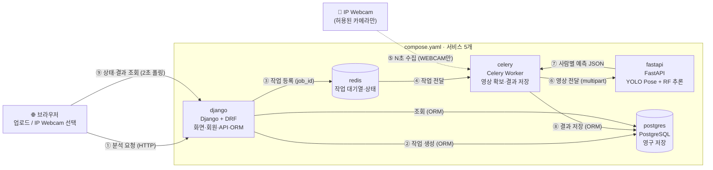
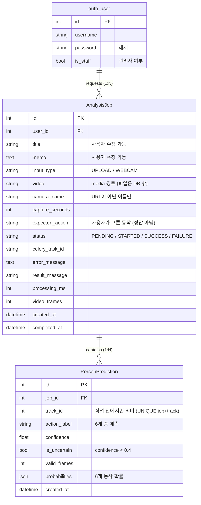
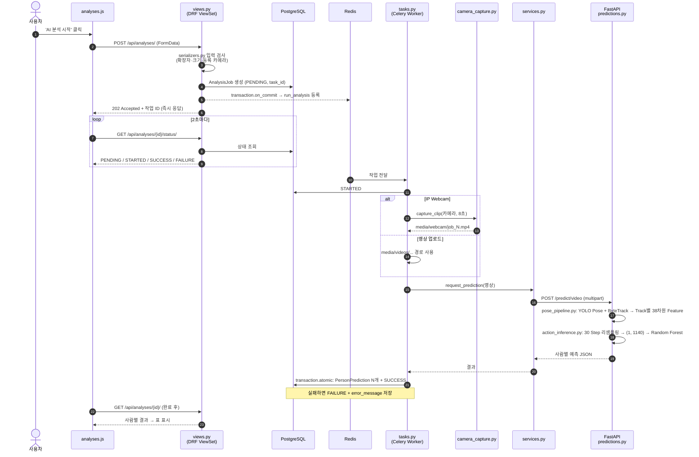
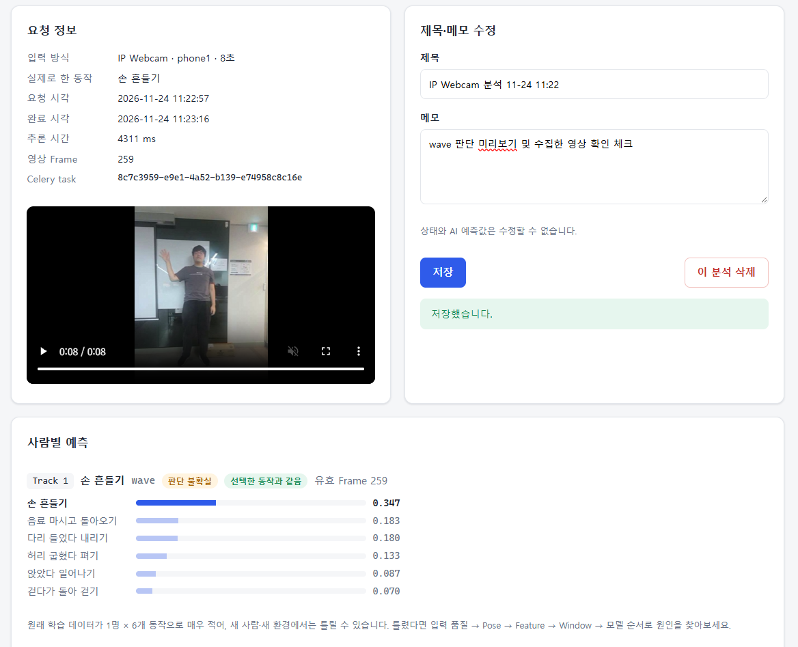
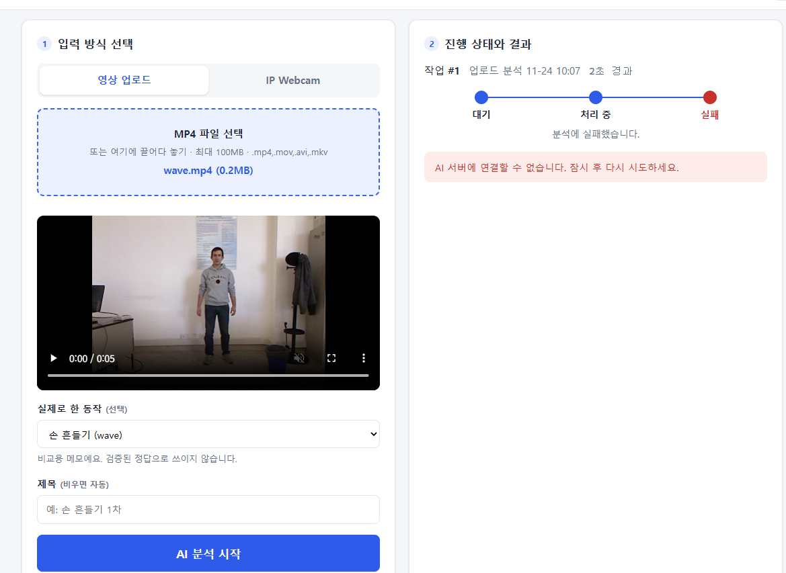
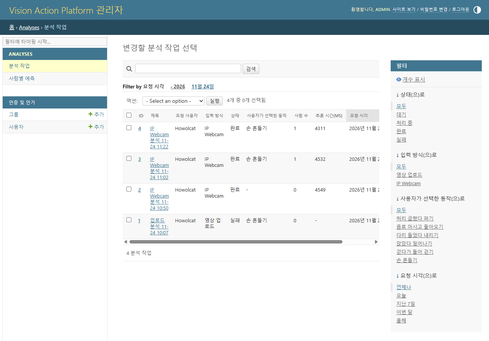
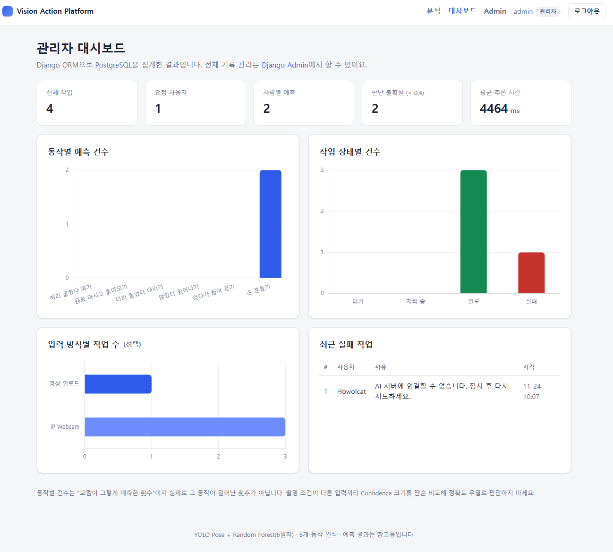
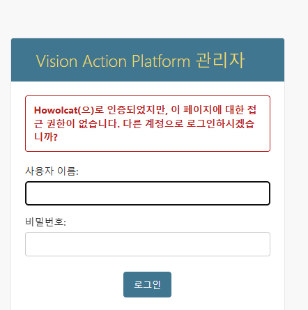

# Vision Action Platform

> 6일차에 학습한 **6개 동작 인식 Random Forest**를 다시 학습하지 않고 재사용해서,
> 브라우저에서 AI 분석을 요청하고 → 비동기로 추론하고 → 결과를 DB에 저장하고 → 관리자가 대시보드로 확인하는 웹 서비스

---

## 1. 프로젝트 소개

사용자가 **영상 업로드** 또는 **IP Webcam(휴대폰 카메라로 짧게 수집)** 으로 동작 영상을 넣으면,
YOLO Pose로 사람마다 관절을 추적하고 6일차 Random Forest로 **사람별 동작(6개 중 1개)과 Confidence**를 예측합니다.
분석은 Celery Worker가 비동기로 처리하므로 사용자는 작업 ID를 바로 받고 진행 상태를 확인할 수 있으며,
결과는 PostgreSQL에 저장되어 관리자가 Django Admin과 Chart.js 대시보드로 전체 기록을 볼 수 있습니다.

| 지원 입력 | 설명 |
|---|---|
| 영상 업로드 | 이미 촬영한 MP4(.mov/.avi/.mkv)를 올려 분석 |
| IP Webcam | 서버(Celery Worker)가 등록된 카메라에 연결해 **8초**(5~10초 조절) 동안 수집한 영상을 분석. 화면에서 **실시간 미리보기**와 **REC 카운트다운**으로 촬영 구도·시점 확인 |

| ID | Action Label | 의미 |
|---|---|---|
| A001 | `bend_return` | 허리를 굽혔다 펴기 |
| A002 | `leg_raise_lower` | 한쪽 다리를 들었다 내리기 |
| A003 | `walk_turn_walk` | 걷다가 방향을 바꿔 다시 걷기 |
| A004 | `drink_return` | 음료수를 마신 뒤 제자리로 돌아오기 |
| A005 | `sit_stand` | 앉았다 일어나기 |
| A006 | `wave` | 손 흔들기 |

> ⚠️ 예측 Label은 정답이나 위험행동 판정이 아닙니다. 학습하지 않은 동작도 6개 중 하나로 예측될 수 있어 Confidence(0.4 미만은 "판단 불확실")와 함께 표시합니다.

---

## 2. 실행 방법

### 2-1. 모델 파일 준비 (Git에 없음)

`day06_model_pack`의 파일을 `ai_service/models/`에 넣습니다. JSON 2개와 체크섬 파일은 저장소에 포함되어 있고, **가중치 2개는 직접 복사**해야 합니다.

```text
ai_service/models/
├── rf_action_baseline.joblib   ← 직접 복사 (Git 제외)
├── yolo11n-pose.pt             ← 직접 복사 (Git 제외)
├── rf_feature_columns.json
├── rf_training_info.json
├── SHA256SUMS.txt
└── README_모델팩.txt
```

```bash
cd ai_service/models && sha256sum -c SHA256SUMS.txt && cd ../..   # 4줄 모두 OK
```
FastAPI는 시작할 때도 체크섬을 다시 검사하고, 통과한 파일만 `joblib.load()` 합니다.

### 2-2. Docker로 실행 (권장)

```bash
cp .env.example .env              # 비밀번호, SECRET_KEY, 카메라 주소 수정
docker compose up --build -d      # 5개 서비스 실행 (첫 빌드는 torch 설치로 수 분 소요)
docker compose ps                 # 5개 모두 running / healthy 확인

# 마이그레이션은 django 서비스가 시작할 때 자동 적용됩니다. 수동으로 하려면:
docker compose exec django python manage.py migrate

# 관리자 계정 생성
docker compose exec django python manage.py createsuperuser
```

| 화면 | 주소 |
|---|---|
| 사용자 화면 (회원가입·분석) | http://localhost:8000 |
| 관리자 대시보드 (is_staff) | http://localhost:8000/dashboard/ |
| Django Admin | http://localhost:8000/admin/ |
| FastAPI 문서 (개발용) | http://localhost:8001/docs |

```bash
docker compose logs -f celery     # 작업 처리 로그 확인
docker compose restart            # 재시작 후에도 DB 데이터 유지 (postgres_data 볼륨)
docker compose down               # 종료 (데이터 유지) / down -v 는 DB까지 삭제
```

### 2-3. 로컬 개발 실행 (Docker 없이)

**한 번에 실행 (추천)**: 가상환경을 켜지 않아도 FastAPI와 Django가 같이 켜지고, `Ctrl+C` 한 번으로 둘 다 꺼집니다.

```bash
./run_local.sh
# 가상환경 위치가 기본값(수업 폴더의 .venv, backend/.venv)과 다르면:
AI_PY=/경로/.venv/bin/python WEB_PY=backend/.venv/bin/python ./run_local.sh
```
FastAPI 로그는 `.logs/fastapi.log`에 저장됩니다. `.env`의 `IP_WEBCAM_SOURCES`도 자동으로 읽습니다.

**직접 실행**하려면:

```bash
# 터미널 1: FastAPI (수업용 가상환경)
cd ai_service && uvicorn main:app --reload --port 8001

# 터미널 2: Django (backend/.venv)
cd backend && source .venv/bin/activate
pip install -r requirements.txt
python manage.py migrate && python manage.py createsuperuser
# Redis 없이 흐름만 확인: 작업을 즉시(동기) 실행
CELERY_TASK_ALWAYS_EAGER=1 python manage.py runserver
# Redis가 있다면 터미널 3에서: celery -A config worker -l info --concurrency=1
```
환경변수 `POSTGRES_DB`가 없으면 SQLite, 있으면 PostgreSQL을 사용합니다. (`config/settings.py`)

### 2-4. 테스트

```bash
cd backend && python manage.py test      # 22개: 회원, 권한(T07), 비동기(T05), 저장(T04·T06), 예외(T09), 관리자(T08)
```

---

## 3. 전체 아키텍처

`compose.yaml`이 실행하는 서비스는 **5개**입니다. (Docker는 서비스가 아니라 실행 환경)



| 서비스 | 책임 | 하지 않는 일 |
|---|---|---|
| **django** | 회원, CRUD, 분석 요청 접수, 조회, 화면, 관리자, ORM | AI 학습·추론 |
| **fastapi** | YOLO Pose·Feature·Random Forest 추론 후 JSON 반환 | DB 테이블, ORM, 회원관리 (DB 접근 없음) |
| **celery** | 큐에서 작업을 꺼내 영상 확보 → FastAPI 호출 → ORM 저장 | 화면 렌더링 |
| **redis** | Celery 브로커, 작업 상태 | 영구 업무 데이터 저장 |
| **postgres** | 사용자·분석 작업·사람별 예측 영구 저장 | (Django ORM으로만 접근) |

**설계 포인트**
- FastAPI에는 파일 **경로가 아니라 파일 자체**를 HTTP로 보냅니다. 컨테이너끼리 파일 시스템이 다르고, 각 컨테이너의 `localhost`는 자기 자신이기 때문입니다. 주소는 서비스 이름(`http://fastapi:8000`)을 씁니다.
- django와 celery는 `media_data` 볼륨을 공유해 업로드 영상을 함께 읽습니다.
- FastAPI는 "추론", Django·Celery는 "저장"으로 책임을 나눠, 추론 서버를 교체하거나 늘려도 DB 구조는 바뀌지 않습니다.

---

## 4. DB 설계 (ERD)

직접 작성한 모델: [`backend/analyses/models.py`](backend/analyses/models.py) (`auth_user`는 Django 기본 제공)



| 테이블 | 저장 내용 |
|---|---|
| `auth_user` | 회원 (Django 기본) |
| `AnalysisJob` | "AI 분석 시작" 1번 = 1행. 누가, 어떤 입력으로, 지금 어떤 상태인지 |
| `PersonPrediction` | 작업 안의 사람 1명 = 1행. 영상에 2명이면 작업 1건에 결과 2건 |

- **삭제 정책:** 작업을 지우면 사람별 예측도 함께 삭제(`CASCADE`)되고 영상 파일도 정리됩니다. 처리 중(`PENDING`/`STARTED`)인 작업은 삭제할 수 없습니다(409).
- **수정 정책:** 사용자는 `title`, `memo`만 수정할 수 있습니다. 상태와 AI 결과는 Celery Worker만 기록합니다.

---

## 5. AI 추론 버튼 구현 흐름



| 단계 | 파일 |
|---|---|
| 버튼, 폴링, 결과 표시 | `backend/static/js/analyses.js` |
| 입력 검사 | `backend/analyses/serializers.py` |
| 작업 생성, 커밋 후 등록, 상태 API | `backend/analyses/views.py` |
| 영상 확보, 결과·실패 저장 | `backend/analyses/tasks.py` |
| 웹캠 N초 수집 | `backend/analyses/camera_capture.py` |
| 웹캠 실시간 미리보기 (MJPEG 중계, 주소 비노출) | `backend/analyses/camera_preview.py` |
| FastAPI 호출, 타임아웃·오류 처리 | `backend/analyses/services.py` |
| 추론 API | `ai_service/routers/predictions.py` |
| 영상 → 사람별 Feature | `ai_service/services/pose_pipeline.py` |
| Feature → 예측 | `ai_service/services/action_inference.py` |

---

## 6. 사용한 모델과 입력 형식

| 항목 | 내용 |
|---|---|
| 동작 분류 | `rf_action_baseline.joblib`: RandomForest(300 trees), 입력 **1,140 = 30 Step × 38 Feature** |
| Feature 순서 | `rf_feature_columns.json` (`t00_nose_x` … `t29_right_knee_angle`). 서버 시작 시 `sequence_utils`가 만드는 순서와 일치하는지 검사 |
| 학습 정보 | `rf_training_info.json`: 6 Class, 30 Step, `min_valid_frames` 10 |
| Pose | `yolo11n-pose.pt` (COCO 17 Keypoint), `imgsz=640`, `conf=0.25` (`configs/project.json`) |
| 업로드 형식 | `.mp4 .mov .avi .mkv`, 최대 100MB, 최대 1,800 Frame(30fps 기준 60초) |
| IP Webcam | 기본 **8초**(5~10초) 수집 → MP4로 저장 후 업로드와 같은 경로로 분석 |

**38 Feature (프레임마다):** 골반 중심을 원점으로 옮기고 어깨 폭으로 나눈 관절 17개의 (x, y) 34개 + 팔꿈치·무릎 각도 4개

**학습 조건과 똑같이 맞춘 점** (`reference/scripts/26, 34번` 확인)
- 모든 Frame 처리, 관절 Confidence로 관절을 거르지 않음 (학습 CSV도 좌표를 그대로 기록)
- 사람(Track)마다 클립 전체를 `frame_id` 기준으로 30 Step 리샘플링 → 사람당 예측 1개
- 유효 Frame이 10개 미만인 Track은 예측하지 않고 `skipped_tracks`로 반환

**FastAPI 입출력** (`POST /predict/video`, `multipart/form-data`의 `file`)

```json
{
  "status": "ok",
  "message": "",
  "processing_ms": 4562,
  "uncertain_threshold": 0.4,
  "video": { "frames": 126, "fps": 25.0, "width": 640, "height": 480, "truncated": false },
  "predictions": [
    { "track_id": 1, "action_label": "wave", "confidence": 0.6367, "is_uncertain": false,
      "valid_frames": 126, "first_frame": 0, "last_frame": 125,
      "probabilities": { "bend_return": 0.0567, "drink_return": 0.1067, "leg_raise_lower": 0.1,
                         "sit_stand": 0.08, "walk_turn_walk": 0.02, "wave": 0.6367 } }
  ],
  "skipped_tracks": []
}
```

| HTTP | 의미 | Celery 처리 |
|---|---|---|
| 200 + `predictions` 있음 | 성공 | SUCCESS + 사람별 결과 저장 |
| 200 + `predictions: []` | 영상은 정상, 사람 없음 | SUCCESS + "사람을 찾지 못했습니다" |
| 400 / 413 / 422 | 형식·크기·손상 | FAILURE + 사유 |
| 503 / 연결 실패 / 타임아웃 | AI 서버 문제 | FAILURE + "AI 서버에 연결할 수 없습니다" |

---

## 7. 실행 결과와 검증

### 정상 분석
IP Webcam 8초 수집(259 Frame) → Track 1: `wave`(선택한 동작과 같음), Confidence 0.347로 "판단 불확실" 표시. 수집한 영상을 상세 화면에서 다시 재생할 수 있고, 제목·메모 수정(PATCH)도 저장됨



### 오류·실패
AI 서버(FastAPI)가 꺼진 상태에서 `wave.mp4` 업로드 → 작업은 멈추지 않고 FAILURE로 끝나며 "AI 서버에 연결할 수 없습니다" 메시지를 DB에 저장



### 관리자 (Django Admin · 대시보드)
관리자 계정으로 전체 작업 목록(상태·입력 방식·동작·날짜 필터, 사용자 검색)과 Chart.js 차트 2개(동작별 예측 건수, 작업 상태별 건수) 확인





일반 회원이 `/admin/`에 접근하면 차단됨 (T08 권한 분리)



### 기능 테스트 체크리스트

| 테스트 | 확인 방법 | 결과 |
|---|---|---|
| T01 모델 불러오기 | `GET /health` → 6 Class, 1,140 Feature | ✅ |
| T02 영상 업로드 | `wave.mp4` 업로드 → 결과 | ✅ |
| T03 IP Webcam | 휴대폰 카메라 앞에서 동작 → 결과 | ✅ (8초·259 Frame, wave) |
| T04 사람별 결과 | 2명 영상 → Track별 2건 | ✅ (자동 테스트) |
| T05 비동기 처리 | 요청 직후 202 + 작업 ID | ✅ (자동 테스트) |
| T06 영구 저장 | 완료 후 새로고침 → 결과 유지 | ✅ |
| T07 CRUD 권한 | A가 B의 작업 조회·수정·삭제 → 404 | ✅ (자동 테스트) |
| T08 관리자 | 관리자만 `/dashboard/` 접근 | ✅ (자동 테스트) |
| T09 예외 처리 | 잘못된 파일·카메라 끊김 → FAILURE + 메시지 | ✅ (자동 테스트) |
| T10 Docker | `docker compose restart` 후 데이터 유지 | ✅ (재시작 후 작업·계정 유지) |

### 오류 해결 기록

| 문제 | 확인한 곳 | 원인 | 해결 | 확인 방법 |
|---|---|---|---|---|
| 사람이 있는 영상만 500 에러 | uvicorn 로그 `ModuleNotFoundError: lap` | `model.track()`(ByteTrack)에 필요한 `lap`이 없고, ultralytics 자동 설치가 오프라인에서 실패 | `ai_service/requirements.txt`에 `lap>=0.5.12` 추가 | 같은 영상 재요청 → 200 |
| 연속 요청 시 Track ID가 이어질 위험 | `persist=True` 동작 확인 | 추적기 상태가 YOLO 객체에 저장되는데 모델을 요청 간 공유 | YOLO는 요청마다 새로 생성, RF는 서버 시작 시 1회 로드 | 같은 영상 2회 요청 → 두 번 모두 Track 1부터 |
| `load_config()` 실패 | `src/common.py`의 `CONFIG_PATH` | 설정 파일을 `configs/project.json`에서 찾는데 루트에 둠 | `ai_service/configs/`로 이동 | `/health` 200 |
| 모델 파일이 Git에 올라감 | GitHub 파일 목록 | `.gitignore` 경로(`ai_service/models/`)와 실제 위치가 다름 | 폴더 이동 + `git rm --cached` | `git ls-files`에 없음 |

---

## 폴더 구조

```text
vision_action_platform/
├── backend/                 Django + DRF + Celery (같은 이미지)
│   ├── config/              settings, urls, celery
│   ├── accounts/            회원가입·로그인·로그아웃
│   ├── analyses/            models, serializers, views(API), page_views(화면),
│   │                        tasks(Celery), services(FastAPI 호출), camera_capture, admin, tests
│   ├── templates/           base, login, signup, index, detail, dashboard
│   ├── static/              css/app.css, js/analyses.js, js/dashboard.js
│   ├── requirements.txt
│   └── Dockerfile
├── ai_service/              FastAPI 추론
│   ├── main.py, routers/, services/
│   ├── src/                 1~8일차 Pose·Feature·Sequence 유틸 (복사)
│   ├── configs/project.json
│   ├── models/              모델 팩 (가중치는 Git 제외)
│   ├── requirements.txt
│   └── Dockerfile
├── reference/scripts/       Feature 생성 방식 확인용 기존 스크립트 (실행하지 않음)
├── compose.yaml
├── .env.example
└── README.md
```
